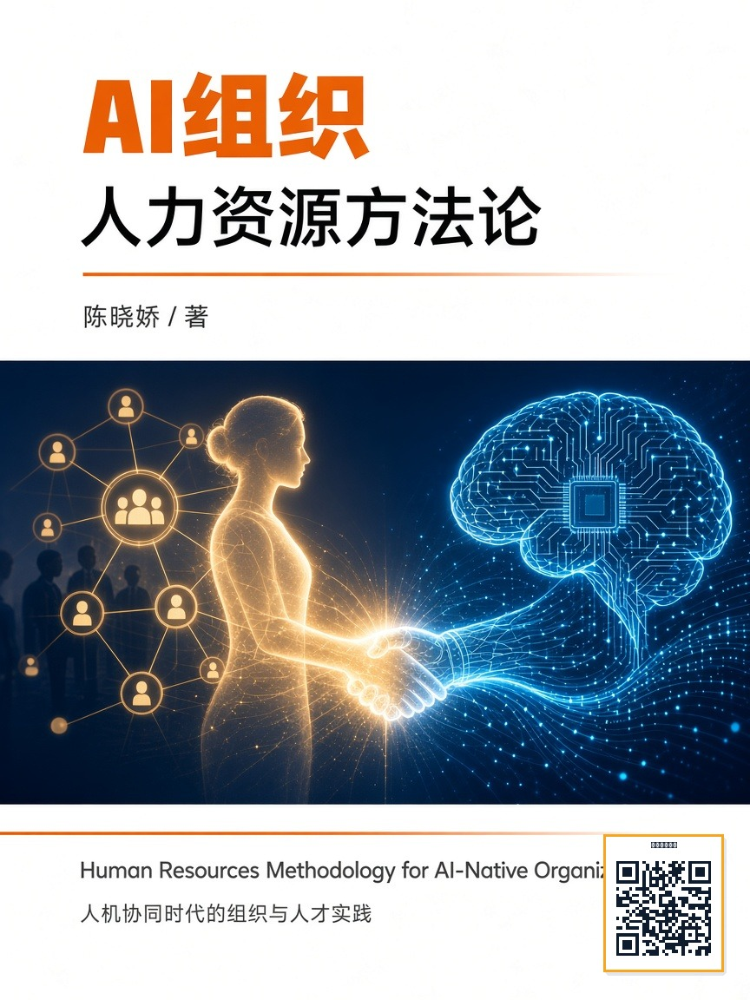

# AI组织人力资源方法论

<p align="center">
  
</p>

<p align="center">
  <strong>AI组织人力资源方法论</strong><br />
  人机协同时代的组织与人才实践
</p>

<p align="center">陈晓娇 著</p>

---

## 简介

本书面向希望在 **AI 组织** 中重新设计人力资源工作的管理者、CHO、HRBP 与组织发展从业者。从「重新理解 AI 组织」出发，覆盖战略、组织设计、人才供应链、能力建设、绩效激励、继任发展、文化变革、数据运营与落地路径，形成一套可对照业务场景使用的方法论。

**核心亮点：**

- **10 章 + 附录** — 从认知框架到 90 天落地路线一条线打通
- **人机协同视角** — 关注责任域、协同界面与判断密度，而不只是上工具
- **可执行模板** — 附录提供工具箱、能力模型/指标模板、自检与复盘表
- **配套 HTML 笔记** — 左侧手风琴目录 + 章节精读，本地浏览器即可打开

> 工具层面的效率提升，并不自动带来组织层面的变化；真正的竞争差距，产生在组织设计与能力供给上。

---

## 在线阅读

站点：[https://cltf.github.io/HRinAINative/](https://cltf.github.io/HRinAINative/)  
封面右下角二维码可扫码直达。

| 入口 | 说明 |
|------|------|
| [`cover.html`](cover.html) | 封面页（含在线阅读二维码） |
| [`index.html`](index.html) | 总目录 |
| [`ch01.html`](ch01.html) ~ [`ch10.html`](ch10.html) | 各章正文 |
| [`appendix.html`](appendix.html) | 附录 |

本地也可用浏览器直接打开上述 HTML。建议从 [`index.html`](index.html) 进入；左侧目录支持点击章节展开小节，其他章节自动收起。

---

## 目录

1. [第一章 重新理解AI组织](ch01.html)
2. [第二章 AI时代的人力资源战略](ch02.html)
3. [第三章 组织设计：为AI重构工作方式](ch03.html)
4. [第四章 人才供应链：选人与识人的升级](ch04.html)
5. [第五章 能力建设：让人与AI一起变强](ch05.html)
6. [第六章 绩效与激励：驱动人机协同产出](ch06.html)
7. [第七章 人才发展与继任：构建组织韧性](ch07.html)
8. [第八章 文化与变革：让组织真正用起来](ch08.html)
9. [第九章 数据驱动的人力资源运营](ch09.html)
10. [第十章 落地路径：从试点到规模化](ch10.html)
11. [附录](appendix.html)

---

## 作者介绍

**陈晓娇** · 希望学职能后台 HR 负责人。聚焦 AI 组织中的人力资源战略、组织设计与人机协同落地。

---

## 仓库说明

| 文件 / 目录 | 用途 |
|-------------|------|
| `AI 组织人力资源方法论.docx` | Word 源稿 |
| `images/cover.jpg` / `cover.png` | 封面图（右下角含在线阅读二维码） |
| `images/qr-site.png` | 站点二维码原图 |
| `cover.html` / `index.html` | 封面页与总目录 |
| `ch01.html` ~ `ch10.html` | 各章 HTML |
| `appendix.html` | 附录 |
| `styles.css` | 页面基础样式 |
| `_convert_docx.py` | 从 Word 源稿生成 / 更新 HTML 的脚本 |

重新从 Word 生成 HTML：

```bash
cd 人力资源
python3 _convert_docx.py
```

> 若已对 HTML 做过手工精修，重新运行脚本会覆盖生成结果，请先确认或备份。

---

## License

学习研究用途。正文与封面版权归作者所有，转载或二次分发请注明出处并征得作者同意。
